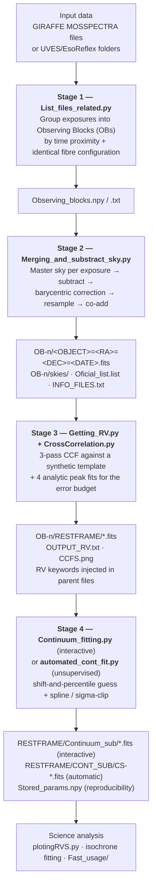

# FLAMES–MOS Pipeline Reduction

**Common tools for handling multi-epoch FLAMES/GIRAFFE and FLAMES/UVES data taken in
Multi-Object Spectrograph (MOS) mode.**

A set of Python tools that takes ESO-pipeline-reduced (Phase-3 / EsoReflex) FLAMES spectra of
the *same field observed many times*, and returns, per epoch group and per star:

* sky-subtracted, barycentric-corrected, co-added 1-D spectra,
* radial velocities measured by cross-correlation against a template, with a full error budget,
* rest-frame spectra,
* normalised (continuum-divided) spectra, either interactively or fully automatically.

The repository also ships a set of **stand-alone tools** that are independent of the
FLAMES pipeline: an interactive/Bayesian isochrone-fitting suite, barycentric-velocity
utilities, and asteroseismic/convective-timescale calculators (see
[Tools outside the pipeline](#tools-outside-the-4-stage-pipeline)).

> **Author** — Ian Baeza (Universidad Andrés Bello / ESO) · <i.baezamardones@uandresbello.edu>
> **License** — CC0 1.0 Universal (public domain dedication)

---

## Table of contents

* [Why this package](#why-this-package)
* [What it does](#what-it-does)
* [Installation](#installation)
* [Quick start](#quick-start)
* [Repository layout](#repository-layout)
* [The four pipeline stages](#the-four-pipeline-stages)
* [Tools outside the 4-stage pipeline](#tools-outside-the-4-stage-pipeline)
* [Output directory structure](#output-directory-structure)
* [Documentation](#documentation)
* [Known limitations](#known-limitations)
* [Citing / acknowledging](#citing--acknowledging)

---

## Why this package

ESO pipelines deliver FLAMES/MOS data as *one file (or one folder) per exposure*, containing
all fibres of the plate — science targets **and** sky fibres — with no notion of "this is the
same star observed 40 times". When the science case is time variability (spectroscopic
binaries, pulsating giants, mass-loss episodes, line-profile variations) you need the opposite
organisation: *one file per star per epoch group*, homogeneously reduced, with a traceable,
reproducible history.

This package performs exactly that reorganisation, plus the standard spectroscopic steps
(sky subtraction, co-addition, barycentric correction, RV by cross-correlation, continuum
normalisation), while keeping every intermediate product on disk so that no step ever
destroys the previous one.

The design principle is *supervised automation*: everything is configured in a **single file**
(`INPUT.py`), run from a **single entry point** (`MAIN.py`), and every stage writes diagnostic
figures and machine-readable logs so that each step can be checked before moving on.

## What it does



Every stage can be run **independently** and re-run without touching the products of the
previous one, because each stage writes into its own sub-folder.

## Installation

No build step — clone and run. You need Python ≥ 3.10 (the walrus-free code uses
`float|None` type unions, so 3.10 is the practical minimum) and:

| Package | Version used by the author | Needed by |
|---|---|---|
| `numpy` | 1.26.4 | everything |
| `scipy` | 1.11.4 | interpolation, splines, curve fitting |
| `astropy` | 5.3.4 | FITS I/O, coordinates, times, barycentric correction |
| `matplotlib` | 3.9.0 | all plots + the interactive GUIs |
| `prettytable` | 3.10.0 | human-readable OB / isochrone tables |
| `tkinter` | stdlib | optional folder/file pickers |

Optional, only for specific stand-alone tools: `astroquery` (`Fast_usage/barycentric_vels.py`),
`scikit-learn` + a local `gls` module (`plotingRVS.py`).

```bash
git clone https://github.com/Inebama/FLAMES-MOS-pipeline-reduction.git
cd FLAMES-MOS-pipeline-reduction/Package_Data_Reduction
python -m pip install numpy scipy astropy matplotlib prettytable
python INPUT.py          # self-check: imports + reads the first data file
```

`python INPUT.py` never processes anything: it only validates that your configuration and
reader functions work. Details in [docs/01_installation.md](docs/01_installation.md).

> **Interactive stages need the `TkAgg` matplotlib backend.** `MAIN.py` explicitly refuses to
> open the Tk folder-picker under other backends. Run the interactive stages from a plain
> terminal, not from an IDE console or a notebook.

## Quick start

The repository ships a working test dataset (two GIRAFFE HR14b epoch groups, 124 fibres,
116 science targets) and a reference output you can compare against.

```bash
cd Package_Data_Reduction
```

1. Open `INPUT.py`, set `path_input` / `path_output` (always end paths with `/`).
   The defaults already point at `TESTING_FOLDER/DATA_GIRAFFE/` and
   `TESTING_FOLDER/TEST_OUTPUT/Test_your_attemp/`.
2. Set `LIST = True`, everything else `False`. Run `python INPUT.py`, check the printout,
   then `python MAIN.py`.
3. Inspect `Observing_blocks.txt` in the output folder. If the grouping is right, set
   `MERGE = True` and run `MAIN.py` again.
4. Check `OB-*/Substract_SKY.png` and `OB-*/SKY.png`. Then set `RADIAL_VEL = True` and run again.
5. Check `OB-*/CCFS.png` and `OB-*/OUTPUT_RV.txt`. Then set `CONTINUUM = True` and run again.

Full narrated walkthrough with expected outputs: [docs/02_quickstart.md](docs/02_quickstart.md).

## Repository layout

```
FLAMES-MOS-pipeline-reduction/
├── LICENSE                                  CC0 1.0
└── Package_Data_Reduction/
    ├── INPUT.py                  ← the ONLY file a normal user edits
    ├── MAIN.py                   ← the ONLY file a normal user runs
    ├── User_Functions.py         ← instrument-specific readers (extend here)
    │
    ├── List_files_related.py             Stage 1  Observing-Block definition
    ├── Merging_and_substract_sky.py      Stage 2  sky subtraction + co-addition
    ├── Getting_RV.py                     Stage 3  RV driver script
    ├── CrossCorrelation.py               Stage 3  the CCF engine (class CCF)
    ├── Continuum_fitting.py              Stage 4  interactive normalisation (class cont_fit)
    ├── automated_cont_fit.py             Stage 4  unsupervised normalisation
    │
    ├── single_isochrone_fitting.py       stand-alone: 1 isochrone, nearest-point matching
    ├── multiple_isochrone_fitting.py     stand-alone: N isochrones, Bayesian inference
    ├── plotingRVS.py                     stand-alone: multi-epoch RV analysis / periodograms
    ├── Review_Multiple_Epochs.py         stand-alone: interactive multi-epoch spectrum viewer
    ├── cheating.py                       stand-alone: scripted bookkeeping recipes
    │
    ├── Fast_usage/                       "manual mode" — use the engines on arbitrary spectra
    │   ├── Fast_RV.py                        minimal CCF example
    │   ├── Fast_continuum.py                 minimal continuum-GUI example
    │   ├── barycentric_vels.py               barycentric velocity explorer (SIMBAD + astropy)
    │   ├── stellar_oscillation_params.py     ν_max, ν_ac, Δν, R, M, ρ̄ from log L, Teff, log g
    │   └── convective_turnover.py            local & global convective turnover times
    │
    └── TESTING_FOLDER/
        ├── DATA_GIRAFFE/                 6 GIRAFFE MOSSPECTRA exposures (2 OBs)
        ├── DATA_UVES/                    2 EsoReflex UVES-fibre exposure folders
        ├── SYNTH_TEMPLATE/               4 AUTOKUR/ATLAS9 synthetic templates
        └── TEST_OUTPUT/                  reference results to compare against
```

## The four pipeline stages

| # | Module | What it does | Key outputs |
|---|---|---|---|
| 1 | `List_files_related.py` | Sorts exposures by MJD and groups every exposure lying within ±`Range_in_hours…/24` days of a seed exposure into one **Observing Block**, provided the science fibre RA/DEC lists match to 0.5″ and have identical length. | `Observing_blocks.npy`, `Observing_blocks.txt` |
| 2 | `Merging_and_substract_sky.py` | Splits science / sky fibres, builds a **master sky** per exposure (median over sky fibres), subtracts it, scales each spectrum to median 1, applies the **barycentric correction to the wavelengths of each exposure**, interpolates everything onto a common ~3× oversampled grid, and co-adds across exposures. Writes one FITS per star, plus the sky files and QA figures. | `OB-n/<OBJ>=<RA>=<DEC>=<DATE>.fits`, `OB-n/skies/SKY_<MJD>.fits`, `Oficial_list.list`, `INFO_FILES.txt`, `Substract_SKY.png`, `SKY.png` |
| 3 | `Getting_RV.py` + `CrossCorrelation.py` | Cross-correlates each spectrum with a template over a user RV range using a **coarse → medium → fine 3-pass scan**, fits 4 analytic functions (2 Gaussians, 2 downward parabolas; one of each with the height fixed at 1) to the normalised CCF peak, and combines their scatter, their formal errors and the pixel-sampling limit in quadrature. Writes rest-frame copies and stamps `RV`, `RVERR`, `RVTRUE` into the parent files. | `OB-n/RESTFRAME/*.fits`, `OUTPUT_RV.txt`, `CCFS.png` |
| 4 | `Continuum_fitting.py` / `automated_cont_fit.py` | Builds a continuum guess by **shifting the spectrum in velocity ~2500 times, re-interpolating on the original pixels and taking a high percentile** of the resulting per-pixel distribution; then refines it with a cubic `UnivariateSpline` and asymmetric sigma-clipping — interactively (sliders) or by iterating to convergence. | `RESTFRAME/Continuum_sub/*.fits`, `RESTFRAME/CONT_SUB/CS-*.fits`, `Stored_params.npy` |

Detailed algorithm descriptions, equations and parameter-by-parameter references are in
[docs/06](docs/06_stage1_observing_blocks.md) · [docs/07](docs/07_stage2_sky_and_merging.md) ·
[docs/08](docs/08_stage3_radial_velocities.md) · [docs/09](docs/09_stage4_continuum.md).

## Tools outside the 4-stage pipeline

These are **not** called by `MAIN.py` and are not configured through `INPUT.py`. They are
independent programs that were developed alongside the pipeline and are documented in their
own sections.

| Tool | Purpose | Full documentation |
|---|---|---|
| **`multiple_isochrone_fitting.py`** | Bayesian stellar-parameter inference from a CMD against a **grid of PARSEC isochrones**. The user visually places the grid (distance modulus + A_V) — that visual selection *is* the prior. The likelihood uses a generalised **Mahalanobis distance** with a full 2×2 covariance matrix (photometric + distance + reddening errors, including the magnitude–colour correlation); one model point per 1° cone around the star is kept to avoid density biases; every isochrone column (Teff, log g, mass, luminosity, age, [M/H], …) is propagated with **weighted means and asymmetric weighted dispersions**. Also reports a *Skepticism score* and a *scale_err* quality flag. Multiprocessing over all CPU cores. Output: a FITS binary table. | [docs/12](docs/12_isochrone_fitting.md) |
| **`single_isochrone_fitting.py`** | Lighter interactive tool: pick **one** (M/H, log Age) isochrone, slide A_V and distance modulus onto the CMD, then assign to every star the parameters of the geometrically **nearest** isochrone point (after densifying the isochrone to ~10 000 points). Output: a PrettyTable-formatted text file + a Kiel diagram. | [docs/12](docs/12_isochrone_fitting.md) |
| **`plotingRVS.py`** | Multi-epoch RV analysis: collects `OUTPUT_RV.txt` from several OBs, matches stars by name or sky position, computes mean RVs and combined uncertainties, flags variables with an **adaptive threshold**, runs a **generalised Lomb–Scargle** periodogram per candidate ([GLS](https://github.com/mzechmeister/GLS), Zechmeister & Kürster 2009; falls back to `astropy` or skips), and produces time-series / phase-folded / KDE RV-distribution figures. Bad stars and bad star–epoch combinations are declared in one config block. | [docs/13](docs/13_auxiliary_tools.md#1-plotingrvspy--multi-epoch-radial-velocity-review) |
| **`Review_Multiple_Epochs.py`** | Interactive multi-epoch reviewer: step through your stars and see every epoch's spectrum overplotted with a residual against a reference (mean, median, a chosen epoch, or a template), ±1/3/5σ bands scaled by the local flux, a clickable parameter panel showing any two variables you supply (Teff vs log L, a CMD, …) or RA/DEC by default, plus optional line-profile fitting and bisector. Loads lazily, so it opens instantly on large datasets. | [docs/13](docs/13_auxiliary_tools.md#2-review_multiple_epochspy--interactive-multi-epoch-viewer) |
| **`cheating.py`** | A notebook-like file of four independent, switch-guarded recipes: (1) copy continuum parameters between OBs so all epochs of a star share the same normalisation; (2) build a per-target index of all files across OBs; (3) test rotational broadening of a template; (4) median-combine all epochs of a star into a single multi-extension FITS. | [docs/13](docs/13_auxiliary_tools.md) |
| **`Fast_usage/Fast_RV.py`**, **`Fast_usage/Fast_continuum.py`** | "Manual mode": ~50-line examples showing how to use the `CCF` and `cont_fit` engines on *arbitrary* spectra with no pipeline, no `INPUT.py` and no OB structure. | [docs/11](docs/11_manual_mode.md) |
| **`Fast_usage/barycentric_vels.py`** | Resolves a target in SIMBAD, computes the barycentric velocity correction for any observatory over any MJD range, and decomposes it into Earth-orbital vs observatory-rotation contributions, comparing the classical projection with astropy's full relativistic treatment. | [docs/11](docs/11_manual_mode.md) |
| **`Fast_usage/stellar_oscillation_params.py`** | Asteroseismic scaling relations: R, M, ρ̄, ν_max, ν_ac (both from scaling and *ab initio*), Δν and the corresponding periods, from log L, Teff, log g. Fully referenced. | [docs/11](docs/11_manual_mode.md) |
| **`Fast_usage/convective_turnover.py`** | Local (photospheric, mixing-length theory with an H⁻-opacity + Eddington grey-atmosphere density) and global (Gunn et al. 1998 scaling) convective turnover times, plus the P_max/τ_conv diagnostic for the pulsation regime. | [docs/11](docs/11_manual_mode.md) |

## Output directory structure

```
<path_output>/
├── Observing_blocks.npy                 dict {'OB-0': [file, …], 'OB-1': […]}
├── Observing_blocks.txt                 same, human-readable
└── OB-0/
    ├── <OBJECT>=<RA>=<DEC>=<ISO-DATE>.fits    ← one per science fibre: merged, sky-subtracted
    ├── Oficial_list.list                       the authoritative file list for later stages
    ├── INFO_FILES.txt                          file · RA · DEC · MAG · median counts
    ├── OUTPUT_RV.txt                           the RV catalogue for this OB
    ├── Substract_SKY.png  ·  SKY.png  ·  CCFS.png     QA figures
    ├── skies/
    │   └── SKY_<MJD>.fits                      individual sky fibres + master sky, per exposure
    └── RESTFRAME/
        ├── <same names>.fits                   rest-frame spectra (+ cached continuum guess)
        ├── Stored_params.npy                   interactive continuum parameters per star
        ├── Continuum_sub/<same names>.fits     interactive normalisation
        └── CONT_SUB/CS-<same names>.fits       automatic normalisation
```

Every FITS product, every column and every header keyword is tabulated in
[docs/05_file_formats.md](docs/05_file_formats.md).

## Documentation

| Document | Contents |
|---|---|
| [docs/00 — index](docs/README.md) | Documentation map and reading order |
| [docs/01 — Installation](docs/01_installation.md) | Requirements, backends, self-test, platform notes |
| [docs/02 — Quick start](docs/02_quickstart.md) | Full tutorial on the bundled test data |
| [docs/03 — `INPUT.py` reference](docs/03_input_reference.md) | Every configuration variable, one by one |
| [docs/04 — Data organisation](docs/04_data_organization.md) | Input layouts (GIRAFFE / UVES), output tree, naming |
| [docs/05 — File formats](docs/05_file_formats.md) | HDU-by-HDU, column-by-column, keyword-by-keyword |
| [docs/06 — Stage 1](docs/06_stage1_observing_blocks.md) | Observing-Block definition algorithm |
| [docs/07 — Stage 2](docs/07_stage2_sky_and_merging.md) | Sky subtraction, barycentric correction, co-addition |
| [docs/08 — Stage 3](docs/08_stage3_radial_velocities.md) | CCF algorithm and the RV error budget |
| [docs/09 — Stage 4](docs/09_stage4_continuum.md) | Continuum estimation, GUI manual, automatic mode |
| [docs/10 — Extending](docs/10_extending_user_functions.md) | Adding a new instrument or file format |
| [docs/11 — Manual mode](docs/11_manual_mode.md) | `Fast_usage/` tools |
| [docs/12 — Isochrone fitting](docs/12_isochrone_fitting.md) | Bayesian CMD inference, formalism and outputs |
| [docs/13 — Auxiliary tools](docs/13_auxiliary_tools.md) | `plotingRVS.py`, `cheating.py` |
| [docs/14 — Troubleshooting](docs/14_troubleshooting.md) | Errors, gotchas and known quirks |
| [docs/15 — API reference](docs/15_api_reference.md) | Signatures of every public function/class |

## Known limitations

Read [docs/14_troubleshooting.md](docs/14_troubleshooting.md) before a production run. The most
important points:

* **Stage 2 requires an identical fibre configuration** across all exposures of an OB (same
  science targets, same count, matched within 0.5″). Mixed plate configurations must be split
  into different OBs (reduce the time threshold) or reduced separately.
* **No error propagation and no flux calibration.** Robustness comes from median combination
  and from a 99th-percentile clip inside the CCF; UVES `ERR_*` frames are not read.
* **Stage 4 only reads FITS files**; ASCII spectra must be converted first.
* **The merged spectra are resampled ~3× finer than the native pixels**, which is what makes
  the quoted `RVERR` smaller than a raw-pixel estimate. This is deliberate — the epochs of an
  OB are shifted by different barycentric velocities and therefore sample the line profile more
  finely than any single exposure — but adjacent pixels are correlated, and the factor is a
  single literal in `Merging_and_substract_sky.py` if your cadence does not justify it
  ([docs/08](docs/08_stage3_radial_velocities.md#why-σ_pix-is-evaluated-on-the-combined-grid)).
* **Sky subtraction uses one master sky per exposure**, not a spatially weighted one. A
  per-fibre distance-weight matrix is already computed and available if you want to change that
  ([docs/07](docs/07_stage2_sky_and_merging.md#a-hook-for-position-weighted-sky-subtraction)).
* **Stages 3 and 4 write into their input files** (RV keywords, continuum-guess extension).
  Nothing is destroyed, but snapshot an OB folder if you want pristine copies.
* **The isochrone tools are PARSEC-only**, are memory-hungry with large grids, and take of
  order seconds per star.
* Results should always be cross-checked. This software was written for a specific PhD
  project and generalised afterwards.

## Citing / acknowledging

If this software contributes to a publication, please cite the accompanying software note —
*Baeza, I., "Common tools for using GIRAFFE and UVES data in MOS mode"* — and acknowledge the
repository. The isochrone module builds on the PARSEC isochrones (Nguyen et al. 2022); the
synthetic templates bundled with the test data were produced with ATLAS9/AUTOKUR.

Questions, bug reports and reasonable requests: <i.baezamardones@uandresbello.edu>.
