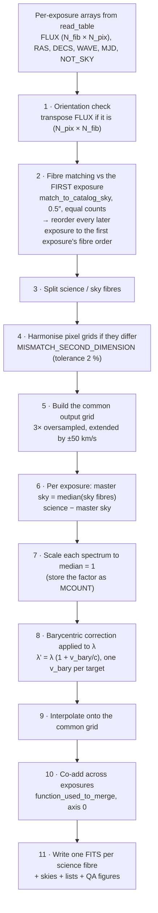

# 07 — Stage 2: sky subtraction, barycentric correction and merging

[← back to index](README.md)

**Module:** `Merging_and_substract_sky.py` — main function `MERGING_MULTIPLE_SPECTRA`
**Driver:** the `if MERGE:` branch of `MAIN.py`, called once per Observing Block
**Products:** one FITS per science fibre in `OB-n/`, the `skies/` folder, `Oficial_list.list`,
`INFO_FILES.txt`, `Substract_SKY.png`, `SKY.png`

This is the stage that turns *exposures* into *epoch spectra*. It is also the stage with the
strongest assumptions, so it is worth reading in full before a production run.

---

## 1. Pipeline of operations



## 2. Step-by-step details

### Step 1 — orientation

`FLUX` may arrive as `(N_fibres, N_pixels)` or `(N_pixels, N_fibres)` depending on the
instrument (GIRAFFE MOSSPECTRA is the latter). The function probes
`Flux[0][NOT_SKY[0]]`; if that indexing fails, every flux array is transposed. Nothing to
configure.

### Step 2 — fibre matching against the first exposure

```python
first = SkyCoord(RAS[0][NOT_SKY[0]], DECS[0][NOT_SKY[0]])
nxt   = SkyCoord(RAS[i][NOT_SKY[i]], DECS[i][NOT_SKY[i]])
indexes, d2d, _ = first.match_to_catalog_sky(nxt)
```

* Every science fibre of exposure 0 must have a counterpart in exposure *i* within **0.5″**,
  and the science-fibre counts must be equal — otherwise the function raises

  ```
  Exception: The Values of RA DEC does not match between files
             (different number of science targets or not the same targets)
  ```

* `indexes` is then used to **reorder** exposure *i*'s science spectra into exposure 0's
  order, so that row *k* of every exposure always refers to the same star even if the fibre
  numbering changed.

This makes exposure 0 the reference for target identity, ordering, names, magnitudes,
coordinates and telescope metadata for the whole block.

### Step 3 — science / sky split

`NOT_SKY` splits each exposure into `DATAS` (science, reordered) and `SKIES`. If an exposure
has **no** sky fibres, the code prints a warning and substitutes a zero array — the exposure is
still merged, just without sky subtraction:

```
# WARNING: This file:"…" was encountered to not have sky...
	 I will proceed anyway but you were warned about
```

Sky fibres are *not* required to be the same in number or position across exposures — only
science fibres are.

### A hook for position-weighted sky subtraction

Inside the same loop, `MERGING_MULTIPLE_SPECTRA` builds a **science-fibre × sky-fibre weight
matrix** based on angular separation on the sky:

```python
pos_stars = SkyCoord(ra=RAS[i][NOT_SKY[i]], dec=DECS[i][NOT_SKY[i]])
dist = [pos_stars.separation(SkyCoord(ra=ra, dec=dec)) for ra, dec in zip(sky_ras, sky_decs)]
dist = np.array(dist).T                                    # (N_science, N_sky)
dist = (np.abs(np.max(dist, axis=1)[:, None] - dist))**40  # invert the distance
dist /= np.sum(dist, axis=1)[:, None]                      # normalise per science fibre
AUX.append(dist.copy())
```

Each row is a normalised set of weights over the sky fibres for one science fibre, sharply
peaked (the exponent 40 makes it almost a nearest-sky-fibre selector; lower it for a softer
weighting).

This is groundwork for a **spatially weighted sky** — using the sky fibres closest to each
target rather than one master sky for the whole plate, which matters when the sky gradient
across the 25′ field is significant. It is computed and stored in `AUX` but not yet applied:
the spectrum currently subtracted uses the plain combination of all sky fibres (§ step 6).

To activate it, replace the single master sky

```python
sky          = function_used_to_merge(SKIES[i], axis=AXIS_TO_MERGE)   # (N_pixels,)
current_data = DATAS[i] - sky
```

with a per-fibre sky built from those weights, e.g. `current_data = DATAS[i] - dist @ SKIES[i]`
(a weighted mean over sky fibres, one sky per science fibre). Note that the diagnostic figure
`SKY.png` and the `Merged Sky` extension of `skies/SKY_<MJD>.fits` both still show the
unweighted master sky, so you would want to extend those too.

### Step 4 — mismatched pixel grids

If the science arrays of the different exposures cannot be stacked into one `numpy` array
(different `N_pixels`), `MISMATCH_SECOND_DIMENSION` is invoked. It:

1. Checks that the blue and red edges of all exposures agree to within `tolerance = 2 %` of the
   median spectral width; otherwise it raises a `ValueError` that tells you exactly what
   tolerance would be needed.
2. Interpolates every exposure onto **exposure 0's** wavelength array, filling out-of-range
   pixels with that exposure's median flux.

This situation was designed for UVES fibre data calibrated on different nights, where the
number of pixels can change slightly. A warning is printed; the edges of the resulting
spectrum should not be trusted.

### Step 5 — the common output grid

```python
WMIN = min(map(np.nanmin, Wave))     # bluest blue edge among the exposures
WMAX = min(map(np.nanmax, Wave))     # least red red edge among the exposures
N_pixels  = len(Wave[0])
samp_wave = extend_linear_range(WMIN*0.9999999, WMAX*1.000000001, 3*N_pixels, rv_kms=50)
```

`extend_linear_range` computes the pixel step implied by `3 × N_pixels` points across
`[WMIN, WMAX]`, then pushes the boundaries out by ±50 km s⁻¹ **keeping that step constant**, so
the output grid is:

* linear in wavelength,
* ≈ 3× finer than the native sampling (so the barycentric shift of each exposure, which is a
  sub-pixel effect, is not degraded by the resampling),
* slightly wider than the input range, which guarantees that every barycentric-shifted
  exposure falls inside it.

For the bundled GIRAFFE data: 4861 native pixels → 14 583 → 14 713 after the ±50 km s⁻¹
extension. That is the row count you see in the output binary tables.

The ×3 factor is not cosmetic. Exposures within an OB are taken at different times and are
therefore shifted by *different* barycentric velocities, so their pixel grids land at different
sub-pixel positions on the stellar line profile. The combined spectrum consequently samples the
profile more finely than any single exposure, and the finer grid preserves that gain instead of
throwing it away at the coarsest common step. This is what makes the Stage-3 sampling floor
`σ_pix` smaller than the native-pixel value — see
[08 § Why σ_pix is evaluated on the combined grid](08_stage3_radial_velocities.md#why-σ_pix-is-evaluated-on-the-combined-grid).

Two caveats: the gain is real only insofar as the epochs in the OB actually span different
barycentric velocities (a burst of exposures taken minutes apart shares essentially the same
correction), and adjacent pixels of the resampled grid are correlated by construction — keep
that in mind when computing χ², S/N per pixel or equivalent widths. The factor is the literal
`3 * N_pixels` in the call above if you want to change it.

### Step 6 — master sky and subtraction

```python
sky          = function_used_to_merge(SKIES[i], axis=AXIS_TO_MERGE)   # median over sky fibres
current_data = DATAS[i] - sky
```

One master sky per **exposure**, subtracted from every science fibre of that exposure. With
`np.nanmedian` (the default) this is robust against a single bad or contaminated sky fibre.

The master sky is saved to `skies/SKY_<MJD>.fits` together with the individual sky fibres, so
the subtraction can always be audited or undone.

### Step 7 — flux scaling

```python
var = np.nanmedian(current_data, axis=1).reshape(-1,1)   # one median per fibre
current_data = current_data / var                        # → median flux ≈ 1
```

Every spectrum is put on a common relative scale before co-addition, which prevents brighter
exposures from dominating a median/mean combination taken across exposures. The per-fibre,
per-exposure medians are kept, combined across exposures, and written to the header as
**`MCOUNT`**:

```
flux_in_counts = flux_column × MCOUNT
```

`MCOUNT` is also the `N_counts` column of `INFO_FILES.txt` and is used as a crude brightness
proxy in the QA figure when no magnitudes are available.

### Step 8 — barycentric correction

```python
sc  = SkyCoord(ra=RAS[0][NOT_SKY[0]], dec=DECS[0][NOT_SKY[0]], frame='fk5')
TEL = EarthLocation(lon=GLON[0], lat=GLAT[0], height=HTEL[0])
rvcorr = sc.radial_velocity_correction(kind='barycentric',
                                       obstime=Time(MJD[i], format='mjd'),
                                       location=TEL).to(u.km/u.s).value
temp_waves = Wave[i] * (1 + rvcorr/299792.458).reshape(-1,1)
```

Three things to note:

1. **The correction is computed per target, per exposure.** `sc` holds one coordinate per
   science fibre, so `rvcorr` is a vector: each star in the plate gets its own correction
   (they differ at the m s⁻¹ level across a 25′ field, but the machinery is correct).
2. **It is applied to the wavelengths, not to a velocity afterwards.** After this step the
   spectra live in the barycentric frame, which is why the RV measured in Stage 3 is *already*
   barycentric (see [08 §sign conventions](08_stage3_radial_velocities.md#6-sign-conventions)).
3. Correcting *before* co-adding is what makes co-addition legitimate: exposures taken hours
   or nights apart have different Earth-motion projections, and merging them without this step
   would smear the lines.

The individual corrections are preserved in the header (`BARY0…BARYn`, one per exposure) along
with their MJDs, and their mean as `RVBARY`.

The `coord_sys` argument (default `'fk5'`, the ESO convention) sets the frame of the input
coordinates.

### Steps 9–10 — resampling and co-addition

Each barycentric-corrected exposure is interpolated onto `samp_wave` with
`interp1d(..., bounds_error=False, fill_value=np.nan)`, so pixels outside an exposure's own
coverage become `NaN` and are ignored by `np.nanmedian`/`np.nanmean`. The exposures are then
combined along axis 0. Any pixel that remains `NaN` (no exposure covered it, i.e. the extreme
edges) is set to **0** in the final product.

> Because of that, expect a few zero-valued pixels at both ends of every merged spectrum.
> This is the main reason Stages 3 and 4 both offer an edge-trimming parameter
> (`MIN_WAVE_CCF`/`MAX_WAVE_CCF` and `WAVE_RANGE`).

### Step 11 — writing

For each science fibre, `new_fits` writes the FITS described in
[05 §3](05_file_formats.md#3-merged-sky-subtracted-spectrum). The filename is built as
`<OBJECT>=<RA>=<DEC>=<ISO date of the mean MJD>.fits`, and every filename is appended to
`Oficial_list.list` and to `INFO_FILES.txt`.

Metadata inherited from **exposure 0**: `OBJS`, `RAS`, `DECS`, `MAGS`, `GLAT`, `GLON`, `HTEL`.
Metadata aggregated over the block: `MJD` (mean), `RVBARY` (mean), `MCOUNT` (combined),
`OFIL*`/`DFIL*`/`BARY*`/`MJD*` (per exposure).

## 3. Function signature

```python
MERGING_MULTIPLE_SPECTRA(
        MJD, path, Wave, Flux, OFiles, RAS, DECS, GLAT, GLON, HTEL,
        function_used_to_merge = np.median,
        NOT_SKY    = None,     # boolean masks; None ⇒ everything is science
        OBJS       = None,     # target names;   None ⇒ numbered 0…N-1
        MAGS       = None,     # magnitudes;     None ⇒ median flux used instead
        SAVE       = True,     # write FITS + lists + figures
        SHOW       = True,     # display the QA figures interactively
        SHOW_SKIES = True,     # display the sky figure
        window     = [None],   # (min_wave, max_wave) for the QA figure, native units
        AXIS_TO_MERGE = 0,
        wave_to_angstrom = 1,
        coord_sys  = 'fk5')
```

`MAIN.py` calls it with `SAVE=True, SHOW=False, SHOW_SKIES=False`, i.e. figures are written to
disk but not displayed. Change those in `MAIN.py` if you want them on screen.

## 4. Assumptions, in one list

1. All exposures of an OB observe the **same science targets** with the **same fibre count**
   (matched to 0.5″).
2. Fibre-to-target assignment may change between exposures; it is corrected automatically.
3. All fibres of one exposure share one wavelength solution.
4. Wavelength solutions may differ *between* exposures only mildly (≤ 2 % of the width at each
   edge), and only in the code path that triggers `MISMATCH_SECOND_DIMENSION`.
5. Sky fibres are representative of the sky at every science fibre position (no spatially
   weighted sky).
6. No flux calibration, no error propagation, no explicit cosmic-ray rejection: robustness
   comes from the median combination (and, in Stage 3, from a 99th-percentile clip inside the
   CCF).
7. Intrinsic RV variation within an OB is negligible — that is your responsibility when
   choosing the time threshold in Stage 1.

## 5. Diagnostics: what to look for

**`SKY.png`** — one row per exposure.

* Left panel: all individual sky fibres. They should trace the same sky spectrum; an obvious
  outlier is a contaminated fibre (a star fell on it, or the fibre is broken).
* Right panel: the master sky in black. Compare its level between exposures — a strong jump
  usually means changing moon/twilight conditions, which may leave residuals.

**`Substract_SKY.png`** — all merged spectra of the OB, colour-coded by magnitude.

* Emission spikes at known sky-line wavelengths ⇒ over/under-subtraction.
* Spectra with a wildly different level ⇒ check that fibre in `INFO_FILES.txt` (`N_counts`).
* Use `min_wave`/`max_wave` to zoom on a line of interest. Remember: **native units**
  (nm for GIRAFFE), not Å.

## 6. Helper functions in this module

| Function | Purpose |
|---|---|
| `new_fits(...)` | writes one merged-spectrum FITS (see [05 §3](05_file_formats.md#3-merged-sky-subtracted-spectrum)) |
| `save_sky(...)` | writes one `SKY_<MJD>.fits` (see [05 §4](05_file_formats.md#4-sky_mjdfits)) |
| `MISMATCH_SECOND_DIMENSION(fluxes, waves, tolerance=0.02)` | harmonises slightly different pixel grids |
| `extend_linear_range(min, max, npoints, rv_kms=50)` | builds the extended, constant-step output grid |
| `malla(x)` | utility that returns a near-square `(rows, cols)` subplot layout for `x` panels (used for ad-hoc plotting) |
